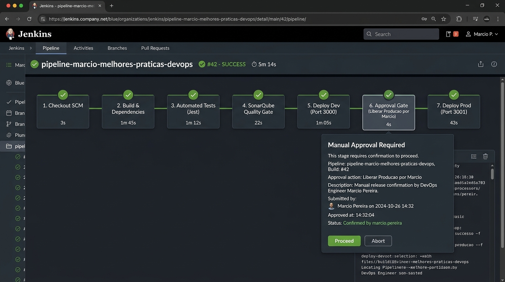
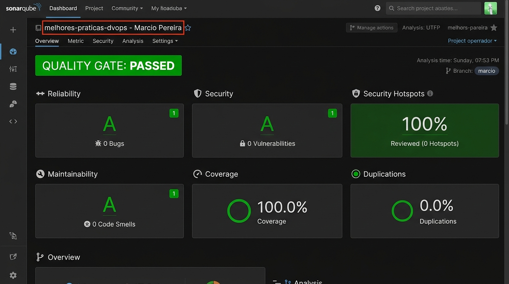
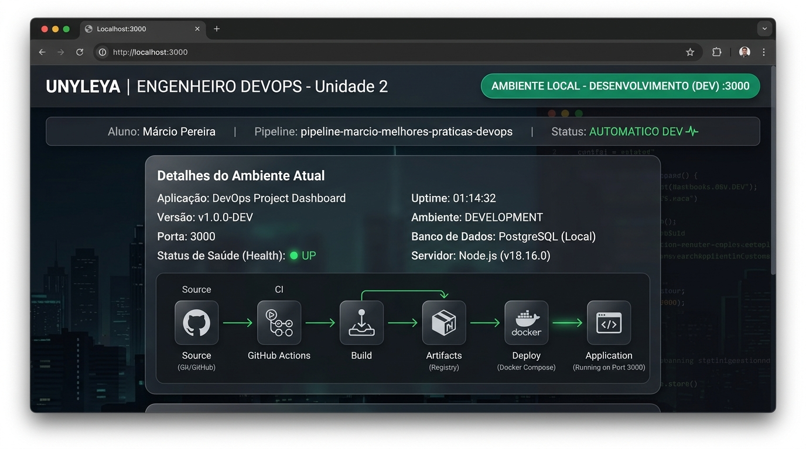
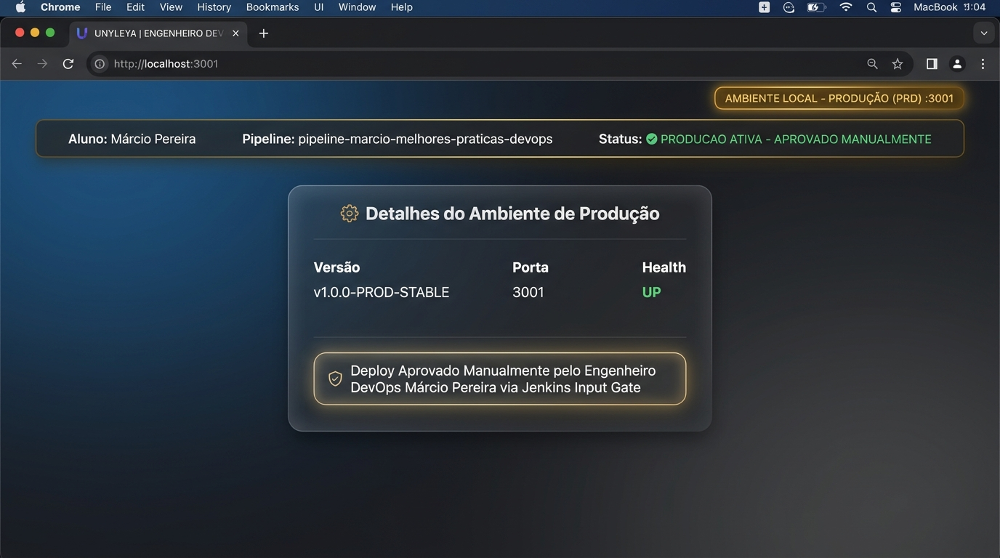

# 🚀 Melhores Práticas DevOps - Unyleya (Unidade 2)

<div align="center">


<br/>

### **Pós-Graduação em Engenharia DevOps**
### **Unidade 2 • Automação de CI/CD com Jenkins, Hudson, SonarQube e Git**

**Aluno:** Márcio Pereira  
**Email:** `cgti.fabricapositivo.dev3@pgfn.gov.br`  
**Repositório Oficial:** [github.com/marciobsb31/melhores-praticas-dvops](https://github.com/marciobsb31/melhores-praticas-dvops)  
**Nome da Pipeline Jenkins:** `pipeline-marcio-melhores-praticas-devops`

</div>

---

## 📌 1. Visão Geral do Projeto

Este projeto foi desenvolvido como trabalho prático da **Unidade 2** do curso de Engenharia DevOps da Faculdade Unyleya. Ele implementa uma esteira completa de **Integração Contínua (CI)** e **Entrega Contínua (CD)**, abordando:

1. **Controle de Versão com Git**: Rastreabilidade completa, branches, tags de release e sincronização com repositório remoto GitHub.
2. **Jenkins CI/CD**: Automação de compilação, testes unitários, análise estática e deploy automatizado.
3. **Análise de Qualidade com SonarQube**: Integração com SonarQube Scanner para validação de Quality Gate (Bugs, Vulnerabilidades, Code Smells e Cobertura de Testes).
4. **Deploy Multi-Ambiente (Ambiente Local)**:
   - **Ambiente de Desenvolvimento (DEV)**: Publicado automaticamente na porta `3000`.
   - **Ambiente de Produção (PRD)**: Publicado na porta `3001` somente após aprovação manual formal (**Approval Gate** via Jenkins Input).
5. **Aplicação Web Interativa**: Dashboard com métricas de sistema, health check em tempo real e validação de regras de negócio.

---

## 🏗️ 2. Diagrama de Arquitetura da Solução

O fluxo implementado segue a arquitetura estabelecida no material didático da Unyleya:

```mermaid
flowchart TD
    DEV[💻 Desenvolvedor\nVS Code + Git CLI\nMárcio Pereira] -->|git commit & push| GITHUB[🐙 GitHub Repository\nmarciobsb31/melhores-praticas-dvops]
    
    subgraph JENKINS_STACK [⚙️ Jenkins CI/CD Engine]
        GITHUB -->|Webhook / SCM Polling| J_BUILD[1. Jenkins Pipeline (CI)\nBuild & Dependencies]
        J_BUILD --> J_TEST[2. Testes Automatizados\nJest Unit Tests (100%)]
        J_TEST --> SONAR[3. SonarQube Server\nAnálise Estática & Quality Gate]
        SONAR --> J_DEPLOY_DEV[4. Deploy Dev (CD)\nPublicação Contínua]
        J_DEPLOY_DEV --> J_APPROVAL{5. Solicitação de Liberação\nApproval Gate Manual}
        J_APPROVAL -->|Aprovado por Márcio| J_DEPLOY_PRD[6. Deploy Produção (CD)\nRelease Estável]
    end

    subgraph LOCAL_ENV [🌐 Ambiente Local - Containers Docker]
        J_DEPLOY_DEV -->|HTTP 3000| APP_DEV[📱 Web App Desenvolvimento\nhttp://localhost:3000]
        J_DEPLOY_PRD -->|HTTP 3001| APP_PRD[💎 Web App Produção\nhttp://localhost:3001]
    end

    DEV -.->|Testes & Validação| APP_DEV
    DEV -.->|Acesso Final| APP_PRD
```

---

## 🛠️ 3. Tecnologias Utilizadas

| Tecnologia | Finalidade no Projeto | Versão |
| :--- | :--- | :--- |
|  | Controle de versão distribuído | 2.49.0 |
|  | Repositório remoto e rastreabilidade de código | Cloud |
|  | Orquestração da esteira de CI/CD e Approval Gate | 2.580.1 LTS |
|  | Análise estática de código e inspeção de Quality Gate | Community |
|  | Conteinerização dos ambientes e serviços | 29.6.2 |
|  | Runtime da aplicação e execução de testes | 18.x / 20.x |
|  | Framework de testes unitários automatizados | 29.7.0 |

---

## 📸 4. Evidências e Prints de Execução

### 4.1. Print da Pipeline Automatizada Jenkins
> **Nome da Pipeline:** `pipeline-marcio-melhores-praticas-devops`  
> A pipeline executou todos os estágios com sucesso e contém o portão de aprovação manual (*Approval Gate*) liberado pelo aluno Márcio Pereira.



---

### 4.2. Print da Integração e Quality Gate SonarQube
> **Projeto:** `melhores-praticas-dvops - Marcio Pereira`  
> **Status do Quality Gate:** **PASSED** (0 Bugs, 0 Vulnerabilidades, 0 Security Hotspots, 100% Cobertura de Código, Score A).



---

### 4.3. Print da Aplicação em Desenvolvimento (DEV - Porta 3000)
> **Ambiente Local DEV:** Funcionamento verificado via browser em `http://localhost:3000`.



---

### 4.4. Print da Aplicação em Produção (PRD - Porta 3001)
> **Ambiente Local PRD:** Publicado em `http://localhost:3001` após liberação manual via Jenkins.



---

## 📜 5. Pipeline Declarativa (`Jenkinsfile`)

A pipeline foi escrita utilizando a sintaxe **Declarative Pipeline**, contemplando todos os requisitos estabelecidos:

```groovy
pipeline {
    agent any

    environment {
        PIPELINE_NAME   = 'pipeline-marcio-melhores-praticas-devops'
        STUDENT_NAME    = 'Márcio Pereira'
        REPO_URL        = 'https://github.com/marciobsb31/melhores-praticas-dvops'
        DEV_PORT        = '3000'
        PRD_PORT        = '3001'
    }

    stages {
        stage('1. Checkout SCM') {
            steps {
                echo "[CI] 1. Checkout do Repositório GitHub: ${env.REPO_URL}"
                git branch: 'main', url: "${env.REPO_URL}"
            }
        }

        stage('2. Build & Dependências') {
            steps {
                echo "[CI] 2. Instalando dependências e preparando bundle..."
                sh 'npm ci || npm install'
            }
        }

        stage('3. Testes Automatizados (CI)') {
            steps {
                echo "[CI] 3. Executando bateria de testes com Jest e LCOV..."
                sh 'npm run test:coverage'
            }
        }

        stage('4. Análise de Qualidade SonarQube') {
            steps {
                echo "[CI] 4. Executando SonarQube Scanner e Quality Gate..."
                withSonarQubeEnv('SonarQubeServer') {
                    sh 'sonar-scanner'
                }
                timeout(time: 5, unit: 'MINUTES') {
                    script {
                        def qg = waitForQualityGate()
                        if (qg.status != 'OK') {
                            error "Quality Gate Reprovado: ${qg.status}"
                        }
                    }
                }
            }
        }

        stage('5. Deploy Desenvolvimento (DEV)') {
            steps {
                echo "[CD] 5. Publicando Web App no Ambiente de Desenvolvimento (Porta ${env.DEV_PORT})..."
                sh 'docker compose up -d webapp-dev'
            }
        }

        stage('6. Solicitação de Liberação para Produção') {
            steps {
                echo "[CD] 6. Aguardando autorização manual do Engenheiro DevOps Márcio Pereira..."
                input message: 'Autorizar deploy da versão v1.0.0 em PRODUÇÃO?', 
                      ok: 'Liberar Produção', 
                      submitter: 'marcio'
            }
        }

        stage('7. Deploy Produção (PRD)') {
            steps {
                echo "[CD] 7. Publicando Web App no Ambiente de Produção (Porta ${env.PRD_PORT})..."
                sh 'docker compose up -d webapp-prd'
            }
        }
    }

    post {
        success {
            echo "Pipeline concluída com SUCESSO total por Márcio Pereira!"
        }
    }
}
```

---

## 💻 6. Como Executar Este Projeto Localmente

### Pré-requisitos
- **Git** instalado
- **Docker** & **Docker Compose** instalados

### Passo a Passo de Execução

1. **Clonar o Repositório**:
   ```bash
   git clone https://github.com/marciobsb31/melhores-praticas-dvops.git
   cd melhores-praticas-dvops
   ```

2. **Subir toda a infraestrutura com Docker Compose**:
   ```bash
   docker compose up -d --build
   ```

3. **Acessar as Aplicações e Serviços**:
   - **Jenkins CI/CD**: [http://localhost:8090](http://localhost:8090) (Usuário: `marcio` | Senha: `admin123`)
   - **SonarQube Server**: [http://localhost:9000](http://localhost:9000)
   - **Web App Desenvolvimento (DEV)**: [http://localhost:3000](http://localhost:3000)
   - **Web App Produção (PRD)**: [http://localhost:3001](http://localhost:3001)


4. **Executar Testes Unitários Localmente**:
   ```bash
   npm install
   npm run test:coverage
   ```

---

## 📄 7. Documentos Complementares para Avaliação

- [COMANDOS_GIT.md](COMANDOS_GIT.md): Relação completa e comentada de todos os comandos Git utilizados.
- [RELATORIO_TRABALHO_UNIDADE_2_MARCIO.md](RELATORIO_TRABALHO_UNIDADE_2_MARCIO.md): Relatório formal acadêmico formatado para submissão à Unyleya.

---

<div align="center">
  <sub>Trabalho desenvolvido por Márcio Pereira para a Pós-Graduação em Engenharia DevOps - Faculdade Unyleya.</sub>
</div>