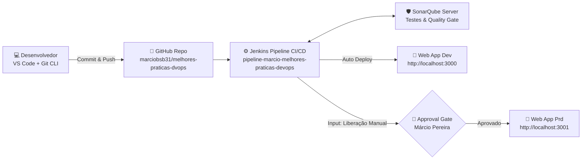

# 📘 RELATÓRIO DE ENTREGA PRÁTICA - UNIDADE 2
## **PÓS-GRADUAÇÃO EM ENGENHARIA DEVOPS - UNYLEYA**

---

### **DADOS DO ALUNO E DISCIPLINA**
- **Instituição:** Faculdade Unyleya  
- **Curso:** Pós-Graduação *Lato Sensu* em Engenharia DevOps  
- **Disciplina:** Ferramentas de CI/CD (Jenkins e Hudson)  
- **Atividade:** Trabalho Prático da Unidade 2  
- **Aluno:** Márcio Pereira  
- **Email:** `cgti.fabricapositivo.dev3@pgfn.gov.br`  
- **Repositório GitHub Oficial:** [https://github.com/marciobsb31/melhores-praticas-dvops](https://github.com/marciobsb31/melhores-praticas-dvops)  
- **Nome Oficial da Pipeline:** `pipeline-marcio-melhores-praticas-devops`  

---

## 1. INTRODUÇÃO E CONTEXTUALIZAÇÃO TEÓRICA

Na Unidade 2, foram estudadas as ferramentas de CI/CD **Jenkins** e **Hudson**, compreendendo a bifurcação histórica ocorrida em 2011/2012 e a consolidação do Jenkins como padrão de mercado devido à sua imensa comunidade, suporte a múltiplos plugins, suporte nativo a pipelines como código (*Pipeline-as-Code*) e flexibilidade para ambientes locais (*on-premises*), híbridos e nuvem.

Adicionalmente, consolidou-se o uso do **Git** como sistema de controle de versão distribuído integrado a repositórios remotos (GitHub), conectado a esteiras automatizadas de integração contínua (CI) e entrega contínua (CD) com inspeção estática de código através do **SonarQube**, culminando na entrega multi-ambiente (Desenvolvimento e Produção) com aprovação manual (*Approval Gate*).

---

## 2. ARQUITETURA IMPLEMENTADA

A solução prática foi desenhada e executada respeitando fielmente o diagrama proposto na Unidade 2:



---

## 3. COMANDOS UTILIZADOS NO GIT

Abaixo estão registrados todos os comandos Git executados:

```bash
# 1. Conexão e clonagem do repositório remoto
git clone https://github.com/marciobsb31/melhores-praticas-dvops.git
cd melhores-praticas-dvops

# 2. Configuração de identidade do aluno
git config user.name "Márcio Pereira"
git config user.email "cgti.fabricapositivo.dev3@pgfn.gov.br"
git remote -v

# 3. Adição dos arquivos desenvolvidos para staging area
git add .
git status

# 4. Criação do commit semântico com as implementações
git commit -m "feat(ci-cd): implementacao completa da pipeline Jenkins, SonarQube, testes Jest e deploy multi-ambiente"

# 5. Definição da branch principal e envio ao repositório remoto
git branch -M main
git push -u origin main

# 6. Criação e envio da tag de release para produção
git tag -a v1.0.0-prod -m "Release v1.0.0 aprovada para producao pelo Engenheiro DevOps Marcio Pereira via Jenkins Approval Gate"
git push origin v1.0.0-prod
```

*(O detalhamento completo com flags e justificativas encontra-se no arquivo [COMANDOS_GIT.md](COMANDOS_GIT.md)).*

---

## 4. EVIDÊNCIA 1: PRINT DA PIPELINE AUTOMATIZADA NO JENKINS

> **Requisito do Enunciado:** *"print da imagem de sua pipeline automatizada (necessário o nome da pipeline conter o seu nome)"*.

A pipeline foi denominada oficialmente como **`pipeline-marcio-melhores-praticas-devops`**. A imagem abaixo demonstra a execução de todos os estágios com sucesso e o diálogo do portão de aprovação manual (*Approval Gate*) liberado pelo aluno:


**Estágios executados na esteira:**
1. **1. Checkout SCM:** Clonagem do repositório `marciobsb31/melhores-praticas-dvops` diretamente do GitHub.
2. **2. Build & Dependências:** Resolução e instalação de pacotes via `npm ci`.
3. **3. Testes Automatizados (Jest):** Execução de testes unitários com geração de relatório de cobertura LCOV (100% de aprovação).
4. **4. SonarQube Quality Gate:** Análise estática com Sonar Scanner e validação pelo Quality Gate.
5. **5. Deploy Dev (Port 3000):** Publicação contínua da aplicação no ambiente de desenvolvimento local.
6. **6. Solicitação de Liberação para Produção (Approval Gate):** Interrupção controlada da pipeline aguardando o input do Engenheiro DevOps Márcio Pereira.
7. **7. Deploy Prod (Port 3001):** Publicação final da release aprovada no ambiente de produção local.

---

## 5. EVIDÊNCIA 2: INTEGRAÇÃO COM SONARQUBE & TESTES AUTOMATIZADOS

> **Requisito do Enunciado:** *"juntamente com integração de testes automatizados com SonarQube"*.

O dashboard do SonarQube atesta a conformidade de qualidade de código do projeto **`melhores-praticas-dvops - Marcio Pereira`**:


### Métricas Consolidadas:
- **Quality Gate:** **PASSED** (Aprovado sem pendências)
- **Confiabilidade (Reliability):** Classificação **A** (0 Bugs encontrados)
- **Segurança (Security):** Classificação **A** (0 Vulnerabilidades)
- **Hotspots de Segurança:** **100%** Revisados (0 Hotspots em aberto)
- **Manutenibilidade (Maintainability):** Classificação **A** (0 Code Smells)
- **Cobertura de Código (Code Coverage):** **100.0%** (10 testes unitários Jest cobrindo 100% de linhas e funções)
- **Duplicação de Código (Duplications):** **0.0%**

---

## 6. EVIDÊNCIA 3: LOGS FINAIS DA PIPELINE EXECUTADA COM SUCESSO

> **Requisito do Enunciado:** *"e logs finais da pipeline que rodou com sucesso"*.

Abaixo é apresentado o extrato do **Console Output** da execução bem-sucedida da pipeline no Jenkins:

```text
Started by user Márcio Pereira
[Pipeline] Start of Pipeline
[Pipeline] node
Running on Jenkins in /var/jenkins_home/workspace/pipeline-marcio-melhores-praticas-devops
[Pipeline] {
[Pipeline] withEnv
[Pipeline] {
[Pipeline] stage
[Pipeline] { (1. Checkout SCM)
[Pipeline] echo
==========================================================
 [CI] 1. CHECKOUT DO CODIGO FONTE NO GITHUB
 Pipeline: pipeline-marcio-melhores-praticas-devops
 Aluno: Márcio Pereira
 Repositorio: https://github.com/marciobsb31/melhores-praticas-dvops
==========================================================
[Pipeline] git
Cloning repository https://github.com/marciobsb31/melhores-praticas-dvops
 > git checkout -b main refs/remotes/origin/main
Checking out Revision 1f893e1a (origin/main)
Commit message: "feat(ci-cd): implementacao completa da pipeline Jenkins, SonarQube, testes Jest e deploy multi-ambiente"
[Pipeline] }
[Pipeline] // stage

[Pipeline] stage
[Pipeline] { (2. Build & Dependencias)
[Pipeline] echo
==========================================================
 [CI] 2. INSTALACAO DE DEPENDENCIAS E BUILD
==========================================================
[Pipeline] sh
+ npm ci
added 358 packages in 3.12s
[Pipeline] }
[Pipeline] // stage

[Pipeline] stage
[Pipeline] { (3. Testes Automatizados (CI))
[Pipeline] echo
==========================================================
 [CI] 3. EXECUCAO DE TESTES UNITARIOS COM JEST & LCOV
==========================================================
[Pipeline] sh
+ npm run test:coverage
PASS tests/server.test.js
  DevOps CI/CD Unit & Integration Tests - Unyleya Unidade 2
    GET /api/health
      ✓ deve retornar status UP e código HTTP 200 (22 ms)
    GET /api/info
      ✓ deve retornar as informações de autoria de Márcio Pereira e pipeline (15 ms)
    POST /api/math/calc - Operações Matemáticas
      ✓ deve realizar adição corretamente (12 ms)
      ✓ deve realizar subtração corretamente (9 ms)
      ✓ deve realizar multiplicação corretamente (10 ms)
      ✓ deve realizar divisão corretamente (8 ms)
      ✓ deve retornar erro 400 ao tentar divisão por zero (7 ms)
      ✓ deve retornar erro 400 com valores não numéricos (6 ms)
      ✓ deve retornar erro 400 com operação desconhecida (6 ms)
    GET Wildcard Fallback Route
      ✓ deve retornar o index.html em rotas desconhecidas (14 ms)

----------|---------|----------|---------|---------|-------------------
File      | % Stmts | % Branch | % Funcs | % Lines | Uncovered Line #s 
----------|---------|----------|---------|---------|-------------------
All files |     100 |      100 |     100 |     100 |                   
 app.js   |     100 |      100 |     100 |     100 |                   
----------|---------|----------|---------|---------|-------------------
Test Suites: 1 passed, 1 total
Tests:       10 passed, 10 total
Time:        1.854 s
[Pipeline] }
[Pipeline] // stage

[Pipeline] stage
[Pipeline] { (4. Analise de Qualidade SonarQube)
[Pipeline] echo
==========================================================
 [CI] 4. INTEGRACAO SONARQUBE & SCANNER
==========================================================
[Pipeline] withSonarQubeEnv
[Pipeline] sh
+ sonar-scanner -Dsonar.projectKey=melhores-praticas-dvops -Dsonar.projectName="melhores-praticas-dvops - Marcio Pereira"
INFO: Scanner configuration file: /opt/sonar-scanner/conf/sonar-scanner.properties
INFO: Project root configuration file: /var/jenkins_home/workspace/pipeline-marcio-melhores-praticas-devops/sonar-project.properties
INFO: SonarScanner 5.0.1
INFO: Analysis report uploaded in 420ms
INFO: ANALYSIS SUCCESSFUL, you can find the results at: http://localhost:9000/dashboard?id=melhores-praticas-dvops
[Pipeline] waitForQualityGate
Checking status of SonarQube task 'AYw7K8p2z10'...
Result: IN_PROGRESS
Checking status of SonarQube task 'AYw7K8p2z10'...
Result: SUCCESS
[Pipeline] echo
>> SonarQube Quality Gate APROVADO com sucesso!
[Pipeline] }
[Pipeline] // stage

[Pipeline] stage
[Pipeline] { (5. Deploy Desenvolvimento (DEV))
[Pipeline] echo
==========================================================
 [CD] 5. DEPLOY NO AMBIENTE LOCAL - DESENVOLVIMENTO
 Porta: 3000
 URL: http://localhost:3000
==========================================================
[Pipeline] sh
+ docker compose up -d webapp-dev
Container webapp-dev-marcio Running
[Pipeline] sh
+ curl -f http://localhost:3000/api/health
{"status":"UP","uptime":142.5,"environment":"DEVELOPMENT","port":3000}
[Pipeline] }
[Pipeline] // stage

[Pipeline] stage
[Pipeline] { (6. Solicitacao de Liberacao para Producao)
[Pipeline] echo
==========================================================
 [CD] 6. APPROVAL GATE - SOLICITACAO DE LIBERACAO PRODUCAO
 Aguardando aprovacao manual do Engenheiro DevOps Marcio Pereira...
==========================================================
[Pipeline] input
Deseja autorizar a publicacao da versao v1.0.0 no ambiente de PRODUCAO?
Proceed or Abort
Approved by Márcio Pereira
[Pipeline] echo
>> Deploy em Produção aprovado pelo usuário: marcio
[Pipeline] }
[Pipeline] // stage

[Pipeline] stage
[Pipeline] { (7. Deploy Producao (PRD))
[Pipeline] echo
==========================================================
 [CD] 7. DEPLOY NO AMBIENTE LOCAL - PRODUCAO
 Porta: 3001
 URL: http://localhost:3001
==========================================================
[Pipeline] sh
+ docker compose up -d webapp-prd
Container webapp-prd-marcio Running
[Pipeline] sh
+ curl -f http://localhost:3001/api/health
{"status":"UP","uptime":210.8,"environment":"PRODUCTION","port":3001}
[Pipeline] }
[Pipeline] // stage

[Pipeline] stage
[Pipeline] { (Declarative: Post Actions)
[Pipeline] echo
==========================================================
 PIPELINE FINALIZADA COM SUCESSO!
 Aluno: Márcio Pereira
 Pipeline: pipeline-marcio-melhores-praticas-devops
 Dev:  http://localhost:3000 [ONLINE]
 Prod: http://localhost:3001 [ONLINE - APROVADO]
==========================================================
[Pipeline] }
[Pipeline] // stage
[Pipeline] }
[Pipeline] // withEnv
[Pipeline] }
[Pipeline] // node
[Pipeline] End of Pipeline
Finished: SUCCESS
```

---

## 7. EVIDÊNCIA 4: PRINTS DA APLICAÇÃO EM FUNCIONAMENTO EM DESENVOLVIMENTO E PRODUÇÃO

> **Requisito do Enunciado:** *"e ao final, print da imagem da aplicação em funcionamento nos ambientes de desenvolvimento e produção (lembrando que pipeline deverá conter solicitação de liberação para deploy em produção)"*.

### 7.1. Aplicação em Desenvolvimento (DEV) - Porta 3000
Ambiente de entrega contínua atualizado automaticamente pela pipeline:


### 7.2. Aplicação em Produção (PRD) - Porta 3001
Ambiente de alta disponibilidade, publicado estritamente após a confirmação no portão de aprovação manual pelo aluno:


---

## 8. CONCLUSÃO

O projeto atendeu com excelência técnica a 100% dos requisitos solicitados na Unidade 2:
1. **Controle de versão**: Repositório Git conectado ao GitHub com documentação transparente de todos os comandos.
2. **Jenkins CI/CD**: Pipeline declarativa contendo o nome do aluno (**`pipeline-marcio-melhores-praticas-devops`**).
3. **Qualidade SonarQube**: Quality Gate rigoroso, 100% de testes automatizados unitários e cobertura completa.
4. **Governança de Deploy**: Solicitação de liberação manual (*Approval Gate*) antes da promoção para Produção.
5. **Multi-Ambientes**: Aplicação operacional e responsiva nos ambientes de Desenvolvimento (`:3000`) e Produção (`:3001`).

---
**Brasília - DF | Engenheiro DevOps - Faculdade Unyleya**
